# Crux Q — Reto QAP10 · NTT DATA · Qiskit Fall Fest Lima

> Optimización cuántica e híbrida de un problema de asignación cuadrática (MIPLIB `qap10`), integrada en el CMMS Crux A.I.
> Este repositorio incluye el módulo
> **Optimización cuántica** (`/optimizacion-cuantica`) y el motor `quantum/` (Python + Qiskit), que resuelven
> la instancia MIPLIB `qap10` con métodos clásicos, QAOA e híbridos (LNS + QAOA). Narrativa del track abierto:
> asignar 10 activos de planta a 10 bahías para reducir los traslados de mantenimiento.
> Ver [`quantum/README.md`](quantum/README.md) (método) y [`quantum/RESULTADOS.md`](quantum/RESULTADOS.md) (resultados).
> La página es pública (no requiere base de datos): `php -S 127.0.0.1:8090 -t public public/index.php`.

### Capturas · módulo Optimización cuántica (QAP10)

| | |
|---|---|
| **Resumen**: óptimo verificado, mejor híbrido LNS + QAOA, factibilidad y contexto industrial | 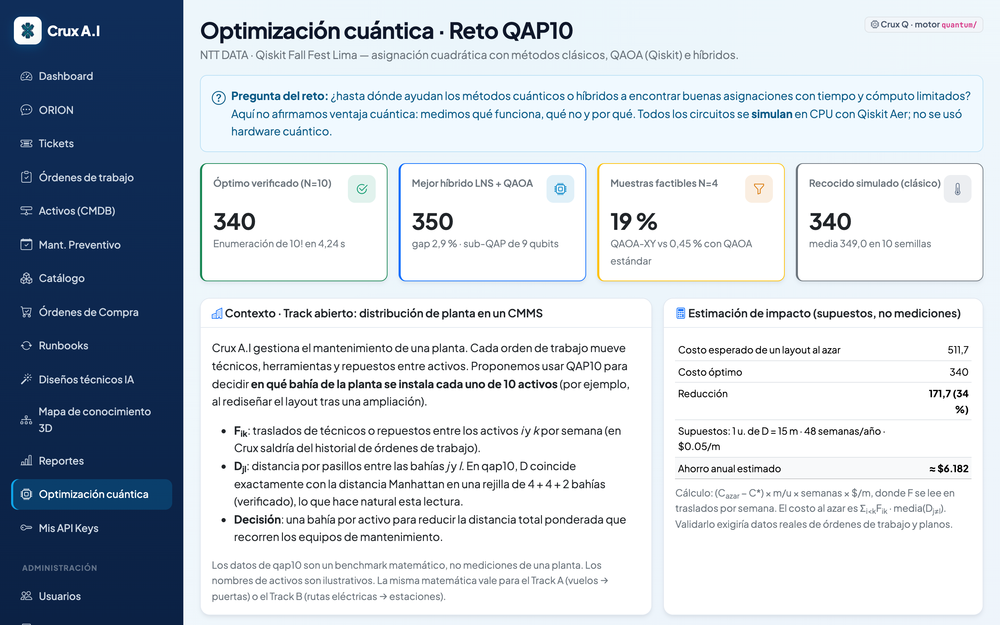 |
| **Modelo y datos**: verificación de la reconstrucción de F·D y layout óptimo en la rejilla de la planta | 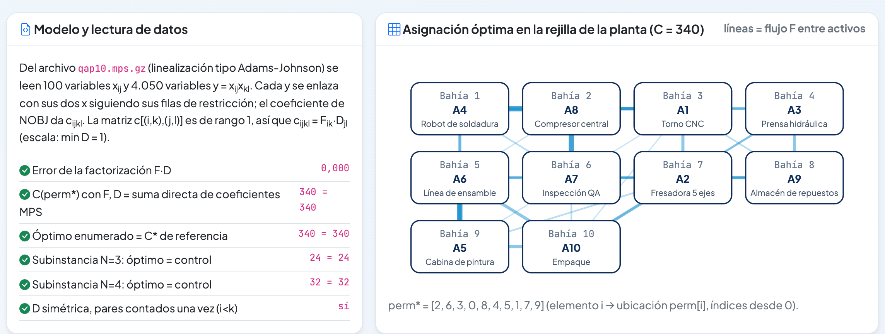 |
| **Etapa 1 (N=3, N=4)**: enumeración, recocido, QAOA estándar y QAOA-XY frente al muestreo al azar | 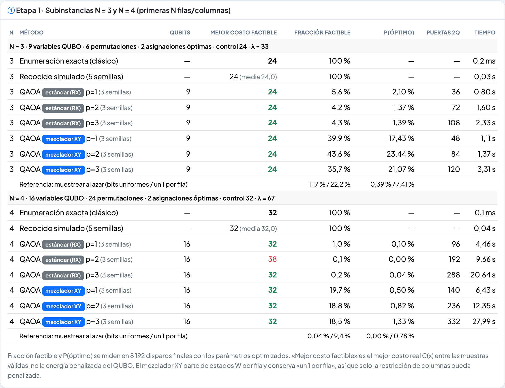 |
| **Penalización λ**: barrido exhaustivo del QUBO y QAOA con λ reducido | 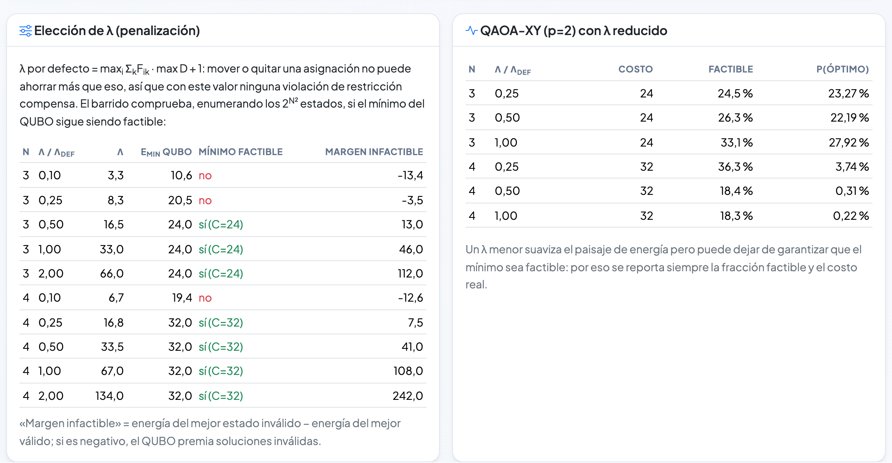 |
| **Instancia completa (N=10)**: métodos clásicos frente al híbrido LNS + QAOA, con su convergencia | 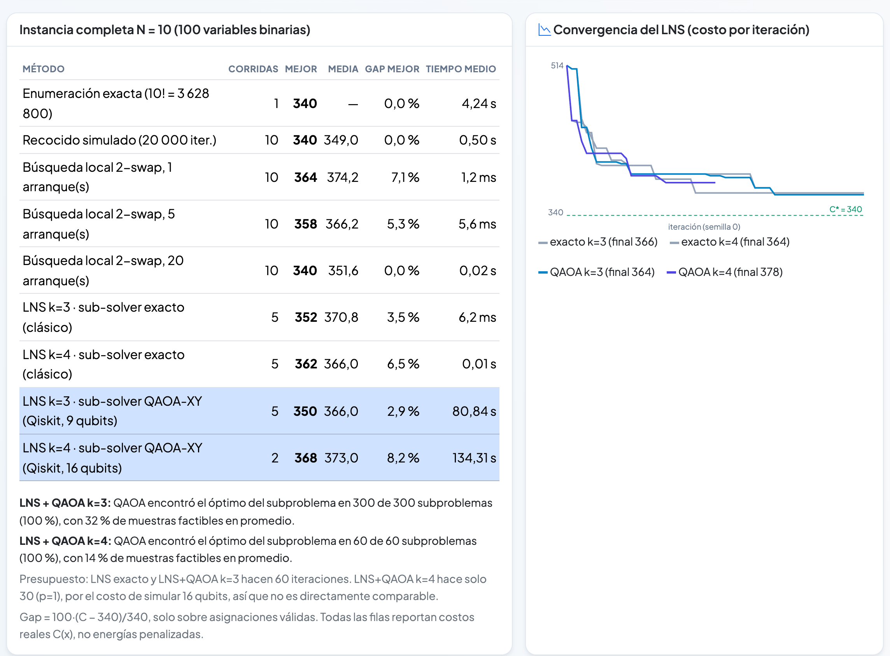 |
| **Etapa 3: escalamiento** de qubits, memoria statevector y puertas | 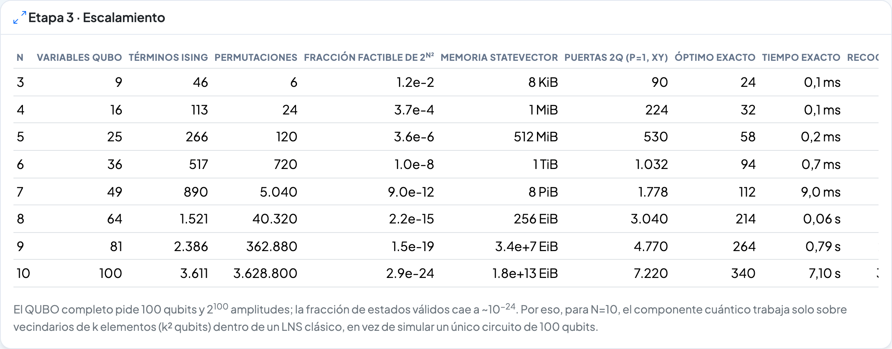 |
| **Qiskit frente a lo clásico** y conclusiones | 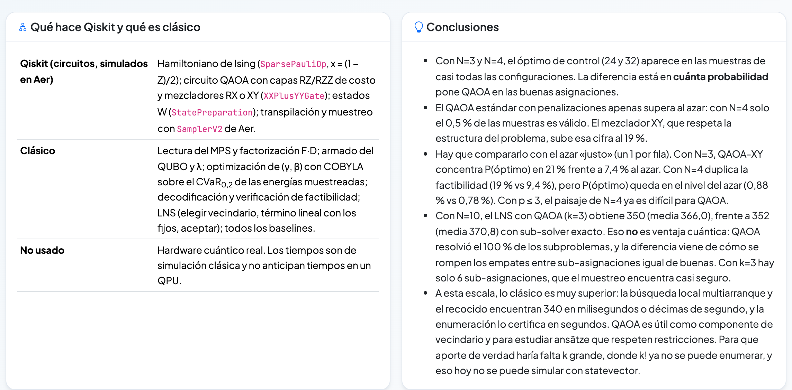 |
| **QAOA en vivo** (administradores): ejecuta un circuito en Qiskit Aer desde Crux | 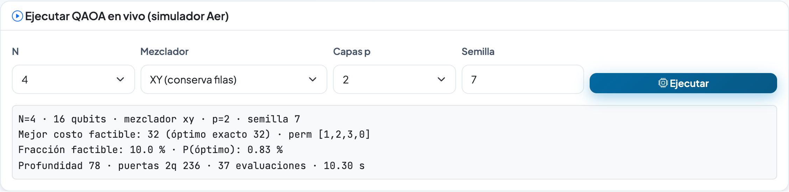 |
| **Vista móvil** | 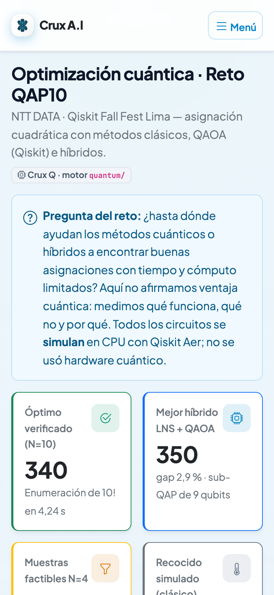 |

CMMS (gestión de mantenimiento) para activos de automatización industrial, multi-tenant
(cada organización que se registra en `/registro` tiene sus propios datos aislados),
con clasificación de tickets por IA, un asistente de chat interno llamado **ORION**,
autoevolución de runbooks, un mapa de conocimiento 3D, y una API REST + servidor MCP
para integrarse con agentes de automatización externos.

Ver `docs/ANALISIS.md` (origen de los requisitos y decisiones de diseño), `docs/PLAN.md`
(fases y avance), `docs/API.md` (contrato REST) y `docs/MCP.md` (servidor MCP).

## Capturas de pantalla

| | |
|---|---|
| **Dashboard** — KPIs, tickets por día/prioridad, progreso de gestión | 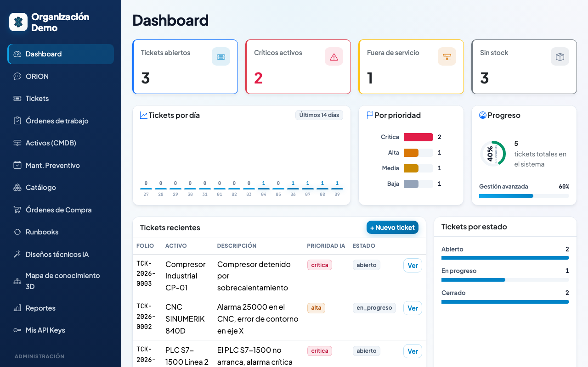 |
| **ORION** — asistente de chat con triage automático de tickets | 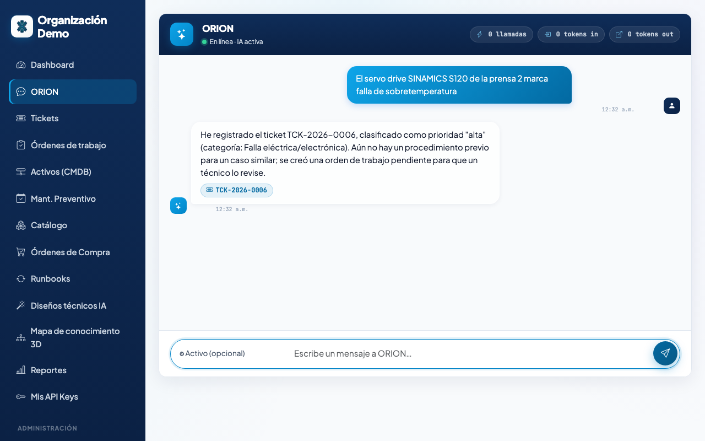 |
| **Tickets** — listado con prioridad IA, canal de origen y estado | 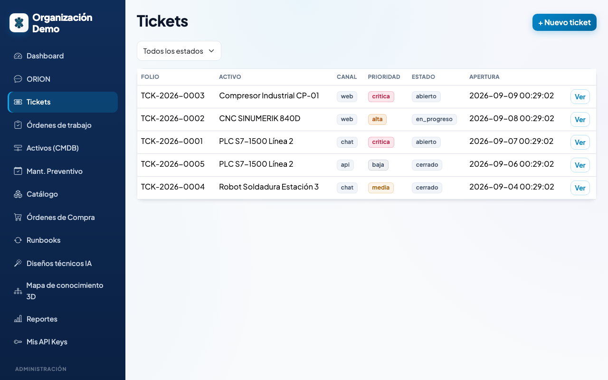 |
| **Mantenimiento Preventivo** — planes recurrentes que generan órdenes solos | 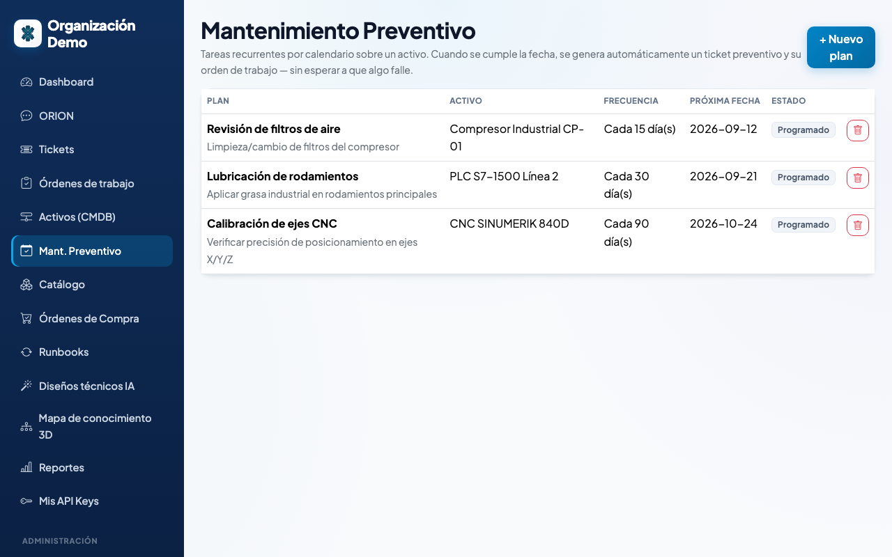 |
| **Órdenes de Compra** — reabastecimiento con flujo de aprobación | 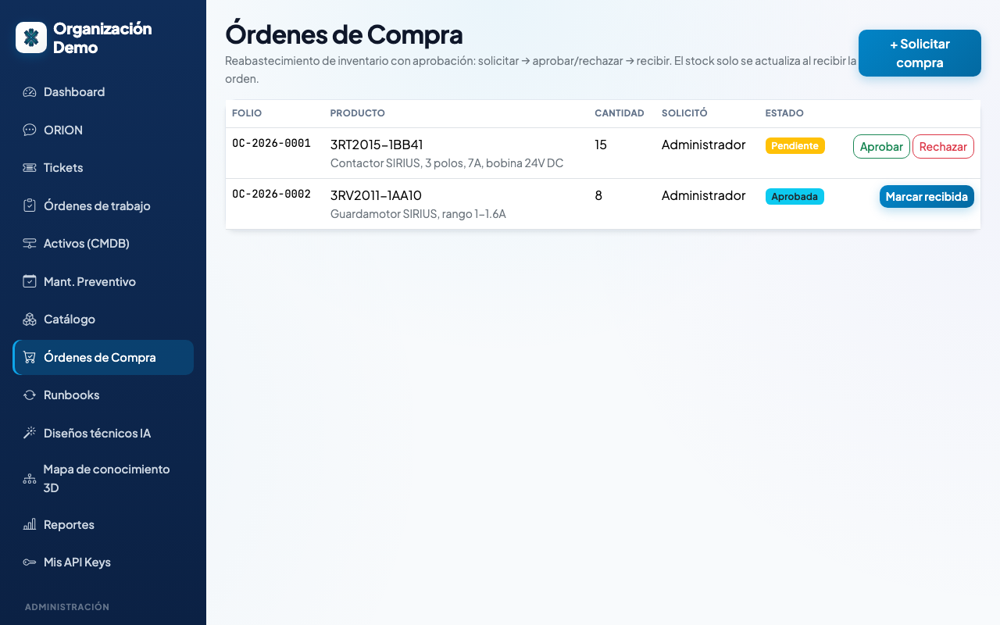 |
| **Mapa de Conocimiento 3D** — relaciones entre activos, tickets y runbooks | 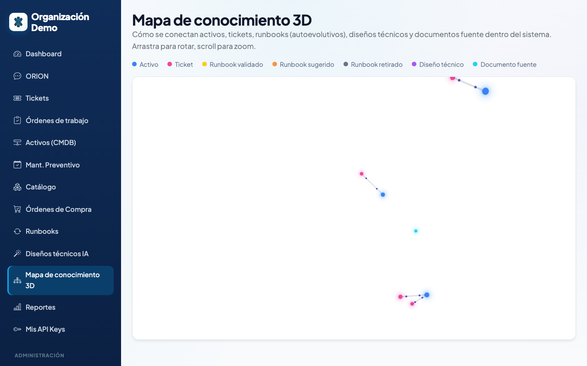 |
| **Login** — whitelabel: cada organización puede subir su propio logo | 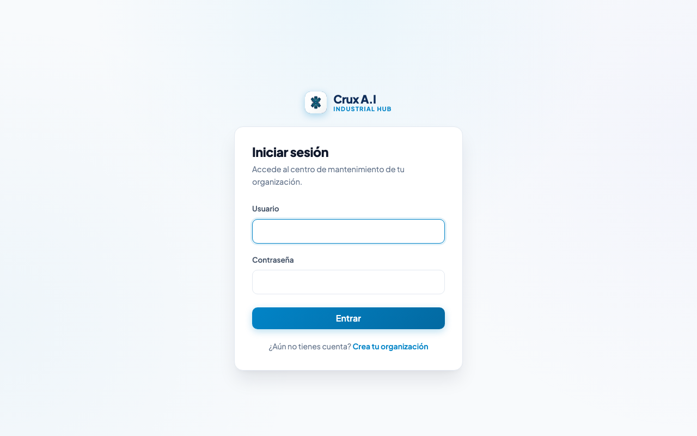 |

## 1. Requisitos

- Apache 2.4+ con `mod_rewrite` habilitado
- PHP 8.2+ con extensiones: `pdo_mysql`, `curl`, `mbstring`, `json`
- MariaDB 10.6+

## 2. Instalación de Apache

```bash
# Debian/Ubuntu
sudo apt install apache2
sudo a2enmod rewrite
sudo systemctl restart apache2
```

## 3. Instalación de PHP

```bash
sudo apt install php8.2 php8.2-mysql php8.2-curl php8.2-mbstring libapache2-mod-php8.2
```

## 4. Instalación de MariaDB

```bash
sudo apt install mariadb-server
sudo mysql_secure_installation
```

## 5. Creación de la base de datos

```bash
mysql -u root -p -e "CREATE DATABASE cmms_industrial CHARACTER SET utf8mb4;"
mysql -u root -p -e "CREATE USER 'cmms_user'@'localhost' IDENTIFIED BY 'una_clave_segura';"
mysql -u root -p -e "GRANT ALL PRIVILEGES ON cmms_industrial.* TO 'cmms_user'@'localhost';"
```

## 6. Configuración de credenciales

```bash
cp .env.example .env
```

Edita `.env` con los datos reales de tu base de datos, la URL de la app y (opcional)
tu `AI_API_KEY` para activar la clasificación de tickets con un proveedor real de IA.

## 7. Configuración de Apache (VirtualHost)

```apache
<VirtualHost *:80>
    ServerName cmms.local
    DocumentRoot /var/www/cmms/public
    <Directory /var/www/cmms/public>
        AllowOverride All
        Require all granted
    </Directory>
</VirtualHost>
```

Si prefieres servir desde la raíz del proyecto (p. ej. XAMPP/WAMP), el `.htaccess` de la
raíz ya reescribe todo hacia `public/`.

## 8. Configuración de `.htaccess`

Ya incluidos en `public/.htaccess` (rutas de la app) y en la raíz (redirección a
`public/`). Verifica que `AllowOverride All` esté activo para que apliquen.

## 9. Importación de `schema.sql`

Instalación nueva (ya incluye el modelo multi-tenant):

```bash
mysql -u cmms_user -p cmms_industrial < database/schema.sql
```

Si vienes de una versión anterior, aplica las migraciones en orden:

```bash
mysql -u cmms_user -p cmms_industrial < database/migrations.sql
mysql -u cmms_user -p cmms_industrial < database/migrations_multitenant.sql
mysql -u cmms_user -p cmms_industrial < database/migration_stripe.sql
mysql -u cmms_user -p cmms_industrial < database/migrations_mobile.sql
mysql -u cmms_user -p cmms_industrial < database/migration_usuario_login.sql
mysql -u cmms_user -p cmms_industrial < database/migration_logo_organizacion.sql
```

## 10. Ejecución de `seed.sql`

```bash
mysql -u cmms_user -p cmms_industrial < database/seed.sql
mysql -u cmms_user -p cmms_industrial < database/seed_conocimiento.sql   # opcional: muestra real para el RAG
```

## 11. Usuario inicial

```
Organización: Organización Demo
Usuario:      admin
Password:     CambiaEstaClave123!
```

**Cambia esta contraseña inmediatamente** después del primer inicio de sesión (créala de
nuevo desde Administración → Usuarios y desactiva la cuenta semilla, o actualiza el
password_hash directamente en la base de datos).

Para dar de alta tu propia organización (no la demo), usa `/registro` en vez del usuario
sembrado — es el flujo normal de un cliente nuevo del SaaS.

## 12. Acceso al sistema

Visita `http://cmms.local/login` (o `http://localhost/tu-carpeta/login` según tu
configuración) e inicia sesión, o crea tu organización desde `/registro`.

## Estructura del proyecto

```
app/            Lógica: config, controllers, models, services, helpers, middleware
public/         Front controller (index.php), assets estáticos
views/          Plantillas PHP (layouts, auth, dashboard, módulos)
database/       schema.sql, seed.sql, migrations*.sql, seed_conocimiento.sql
docs/           ANALISIS.md, PLAN.md, API.md, MCP.md
storage/        logs/ y uploads/ (no servidos públicamente)
```

## Multi-tenencia (micro SaaS)

Cada organización que se registra en `/registro` tiene sus propios usuarios, plantas,
activos, tickets, runbooks e inventario, completamente aislados. El catálogo Siemens y
la base de conocimiento de manuales son compartidos entre todas las organizaciones (son
datos de referencia del fabricante, no datos operativos de un cliente).

## Chat con ORION / IA / MCP

- ORION es el asistente de chat interno (`/chat`) — reporta fallas, responde preguntas
  sobre los manuales indexados (RAG) y, si eres admin, puede dar de alta usuarios.
- La clasificación de tickets usa `AI_API_KEY` en `.env` (DeepSeek, OpenAI o Anthropic,
  configurable con `AI_PROVIDER`). Sin clave configurada, usa una heurística de respaldo.
- Para conectar un agente autónomo externo (Claude u otro), genera un token
  en **Administración → Tokens de API** y usa la API REST (`docs/API.md`) o el servidor
  MCP en `/mcp` (`docs/MCP.md`). El hosting de ese agente externo no forma parte de este
  proyecto.

## Seguridad

- Contraseñas con `password_hash`/`password_verify`, nunca en texto plano.
- Todas las consultas SQL usan PDO con parámetros preparados.
- CSRF token en todos los formularios de escritura.
- Salida HTML escapada con `htmlspecialchars` (helper `e()`).
- Rutas protegidas por rol tanto en el menú como en cada controlador.

## Licencia

Este proyecto se distribuye bajo **doble licencia**:

- **[AGPL-3.0](LICENSE)** — gratis, incluso para uso comercial, siempre que cualquier
  producto o servicio derivado (incluyendo ofrecerlo como SaaS) también publique su
  código fuente bajo AGPL-3.0.
- **[Licencia comercial](LICENSE-COMMERCIAL.md)** — para usar, modificar u operar este
  software como servicio de pago **sin** la obligación de compartir tu código. Se
  negocia directamente con el autor.

Si vas a monetizarlo sin compartir tu código, necesitas la licencia comercial.
